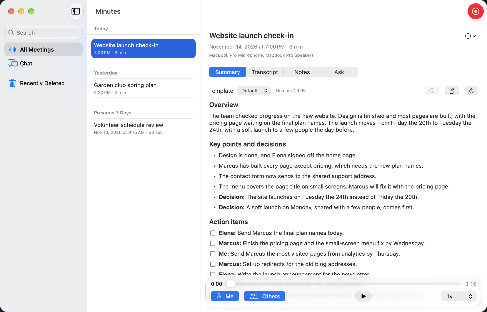
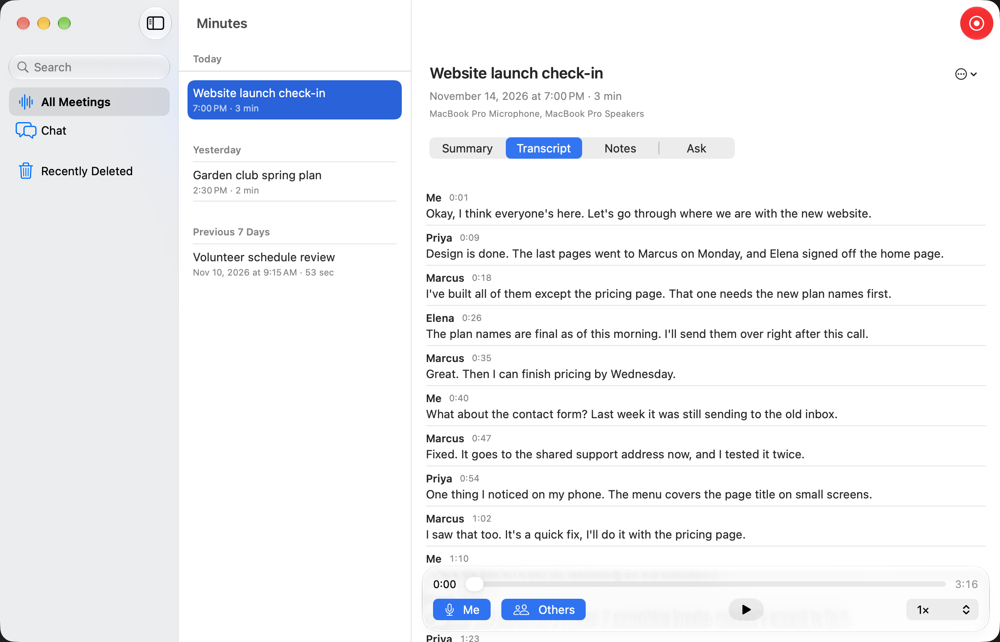
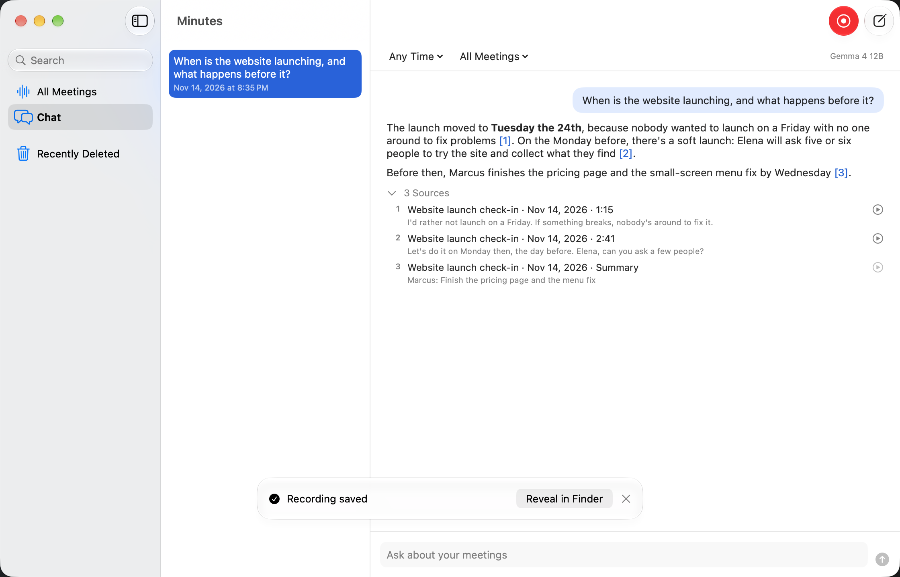
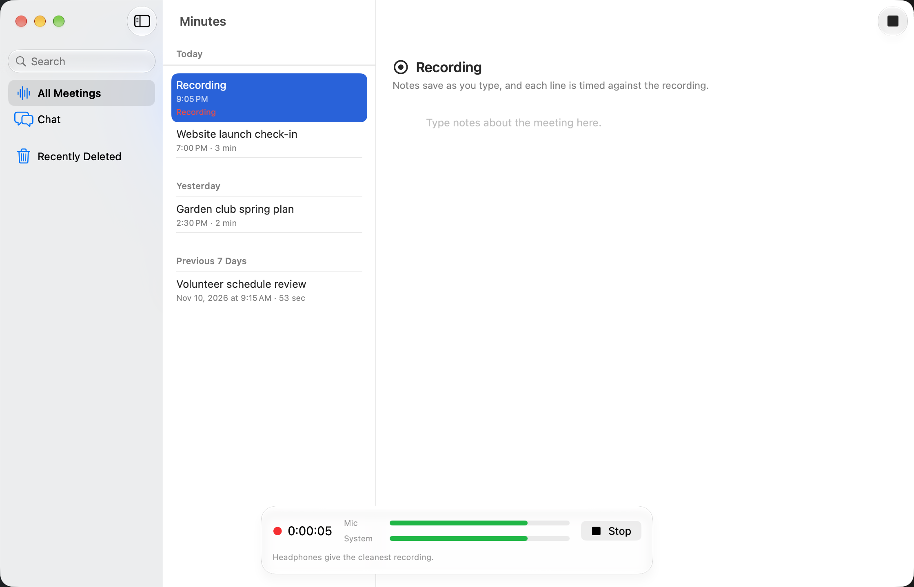
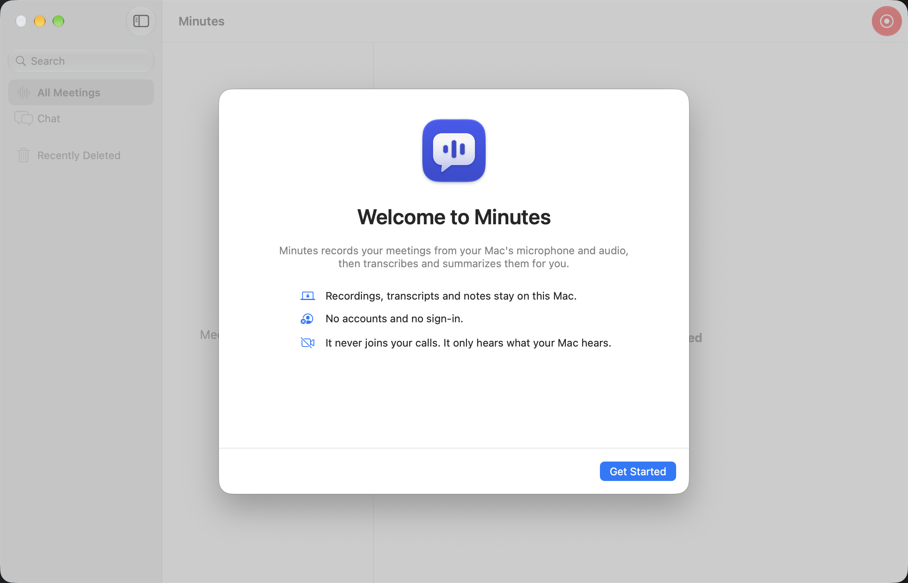

# Minutes

A free, open source meeting recorder for Macs with Apple silicon. Minutes records your microphone and your Mac's audio on separate tracks, then transcribes the meeting, tells the speakers apart and writes a summary, all on your Mac. There are no accounts, nothing is uploaded, and it never joins your calls as a bot.

<picture>
  <source media="(prefers-color-scheme: dark)" srcset="docs/screenshots/summary-dark.png">
  
</picture>

## What it does

- **Records any meeting** from the Mac itself: the microphone and the system audio, kept as two tracks so your voice and everyone else's stay apart. Start from the toolbar, the menu bar or a keyboard shortcut that works in any app.
- **Transcribes on your Mac** with Apple's speech recognition, or the optional Parakeet model. Click any line to hear it.
- **Tells speakers apart** and lets you name them. With Remember voices turned on, it can name people it has heard before.
- **Summarizes** with a local model, Gemma 4, using templates you can edit. Or point it at an OpenAI-compatible server you run yourself.
- **Takes notes** while you record, each line timed against the audio, and tidies them up afterwards if you ask.
- **Answers questions** about one meeting or all of them, with numbered sources that open the transcript at the right moment.
- **Keeps plain files** in `~/Minutes`: the audio, `transcript.json` and `.md`, `summary.md`, `notes.md` and your chats, readable without the app.

<table>
  <tr>
    <td>
      <picture>
        <source media="(prefers-color-scheme: dark)" srcset="docs/screenshots/transcript-dark.png">
        
      </picture>
    </td>
    <td>
      <picture>
        <source media="(prefers-color-scheme: dark)" srcset="docs/screenshots/chat-dark.png">
        
      </picture>
    </td>
  </tr>
  <tr>
    <td>
      <picture>
        <source media="(prefers-color-scheme: dark)" srcset="docs/screenshots/recording-dark.png">
        
      </picture>
    </td>
    <td>
      <picture>
        <source media="(prefers-color-scheme: dark)" srcset="docs/screenshots/first-run-dark.png">
        
      </picture>
    </td>
  </tr>
</table>

The people and meetings in these screenshots are made up.

## Privacy

Your recordings, transcripts, notes, summaries and chats never leave your Mac. Minutes has no accounts, no analytics, no crash reporting and no telemetry of any kind.

It only goes online for these, and each is your choice:

- **Model downloads** from Hugging Face, when you click Download in Settings or choose a model the first time you open Minutes.
- **Update checks**, if you downloaded Minutes from GitHub. It fetches one small file from GitHub Releases and sends nothing about you or your Mac. Turn it off in Settings › General. Copies installed with Homebrew never check.
- **An AI server you add yourself** in Settings › AI Models. Minutes sends it the meeting text it needs for that request. A server outside your network has to use https, and Minutes warns you before saving it and marks it wherever you choose it.

Recording a conversation can need everyone's consent where you live. Getting it is up to you.

## Install

You need a Mac with Apple silicon and macOS 27 or later.

**Download:** get `Minutes-<version>-arm64.dmg` from [the latest release](https://github.com/RossLopez/minutes/releases/latest), open it and drag Minutes to Applications. Minutes checks for updates and asks before installing one. Each release also has a `.sha256` file if you want to check the download.

**Homebrew:**

```bash
brew install --cask rosslopez/tap/minutes
```

Homebrew keeps it up to date, so Minutes' own update checks are off for this copy:

```bash
brew upgrade --cask minutes
```

Uninstalling with `brew uninstall --zap --cask minutes` removes the app's settings and caches, but never your meetings in `~/Minutes`.

The first time it opens, Minutes walks you through your name, the microphone and system audio permissions, and a summary model. Every step can be skipped and changed later in Settings.

## Build from source

You need Xcode 27 and [XcodeGen](https://github.com/yonaskolb/XcodeGen).

```bash
brew install xcodegen
```

```bash
xcodegen generate
```

```bash
open Minutes.xcodeproj
```

Builds are ad-hoc signed by default, so you don't need an Apple account. To sign with your own identity, copy `Config/Local.xcconfig.example` to `Config/Local.xcconfig` and add your Team ID. Debug builds never check for updates.

[CONTRIBUTING.md](CONTRIBUTING.md) has the test and lint commands, and [docs/RELEASING.md](docs/RELEASING.md) explains how releases are built, signed and published.

## Contributing and security

Bug reports, ideas and pull requests are welcome. Please read [CONTRIBUTING.md](CONTRIBUTING.md) and the [code of conduct](CODE_OF_CONDUCT.md) first. To report a security problem privately, see [SECURITY.md](SECURITY.md).

## License

Minutes is licensed under the [GNU General Public License, version 3 or later](LICENSE). The libraries and models it uses, and their licenses, are listed in [THIRD_PARTY_NOTICES.md](THIRD_PARTY_NOTICES.md).
